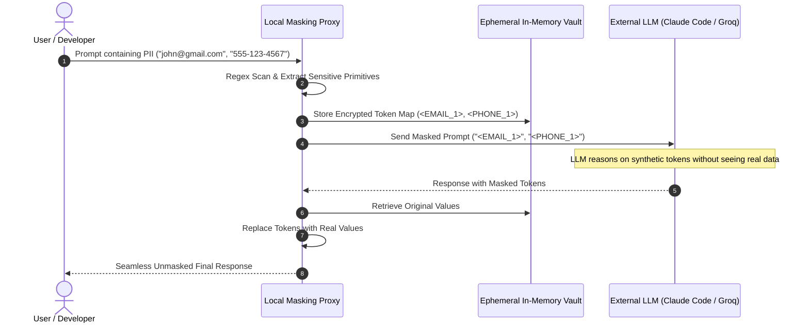

As enterprise engineering organizations rapidly adopt autonomous CLI tools like **Claude Code**, OpenAI, and high-speed inference engines like **Groq**, data privacy has emerged as the most critical hurdle to enterprise adoption. Regulated companies cannot risk sending Personally Identifiable Information (PII)—such as customer emails, telephone numbers, credit cards, or internal API secrets—over the wire into third-party LLM cloud contexts.

Rather than blocking AI usage or waiting for costly private on-prem models, teams can enforce **Zero-Leakage Privacy by Design**: a deterministic client-side privacy proxy that automatically detects, masks, vaults, and unmasks PII before external LLM calls are dispatched.

---

## The Zero-Leakage Architecture

<figure class="my-8 overflow-hidden rounded-xl border border-slate-200 dark:border-slate-800 bg-white dark:bg-slate-900/60 shadow-sm">
  <div class="px-4 py-2 border-b border-slate-100 dark:border-slate-800/80 bg-slate-50/50 dark:bg-slate-900 flex items-center justify-between text-xs text-slate-500 dark:text-slate-400">
    <div class="flex items-center gap-2 font-mono font-medium">
      <span class="inline-block w-2.5 h-2.5 rounded-full bg-blue-500"></span>
      <span>Architecture Flow • PII Protection with LLMs</span>
    </div>
    <span class="text-xs text-slate-400 font-mono">@samuelj90</span>
  </div>
  <div class="p-4 sm:p-6 overflow-x-auto flex justify-center bg-slate-50/30 dark:bg-slate-950/20">
    
  </div>
  <figcaption class="px-4 pb-4 text-xs text-center text-slate-500 dark:text-slate-400 font-mono">
    Figure 1: Reversible Token Masking Pipeline • The third-party LLM never sees raw customer data
  </figcaption>
</figure>

### Architecture Sequence Flow



---

## 1. The 6-Stage Masking Pipeline

1. **PII Detection**: High-speed regex scanners inspect prompts before transmission, matching emails, phone numbers, SSNs, credit cards, and credential patterns.
2. **Token Masking**: Sensitive tokens are replaced with synthetic placeholders (e.g. `john@gmail.com` $\rightarrow$ `<EMAIL_1>`, `555-123-4567` $\rightarrow$ `<PHONE_1>`).
3. **Encrypted In-Memory Vaulting**: The token dictionary is stored in an ephemeral, local memory map on your workstation or proxy. It is **never transmitted to the cloud LLM**.
4. **Cloud LLM Inference**: The LLM processes the syntactic structure with zero exposure to user identity.
5. **LLM Response**: The model produces code, instructions, or summaries referencing the synthetic tokens.
6. **Local Unmasking**: The local proxy swaps the tokens back to real values before outputting results to the developer.

---

## 2. Enforcing This with a Python Privacy Proxy Script

Here is an automated Python script (`pii_guard.py`) that acts as a local CLI wrapper or HTTP proxy to intercept prompts, apply deterministic masking, query the LLM, and unmask responses:

```python
#!/usr/bin/env python3
"""
pii_guard.py • Zero-Leakage PII Protection Proxy
Author: @samuelj90
"""

import os
import re
import sys
import json
import urllib.request

# Regex primitives for PII detection
PATTERNS = {
    "EMAIL": re.compile(r'\b[A-Za-z0-9._%+-]+@[A-Za-z0-9.-]+\.[A-Z|a-z]{2,}\b'),
    "PHONE": re.compile(r'\b(?:\+?\d{1,3}[-.\s]?)?\(?\d{3}\)?[-.\s]?\d{3}[-.\s]?\d{4}\b'),
    "KEY": re.compile(r'\b(?:sk-[a-zA-Z0-9]{32,}|ghp_[a-zA-Z0-9]{36})\b')
}

class PIIGuard:
    def __init__(self):
        self.vault = {}
        self.counters = {"EMAIL": 0, "PHONE": 0, "KEY": 0}

    def mask(self, text: str) -> str:
        masked = text
        for pii_type, pattern in PATTERNS.items():
            def replacer(match):
                val = match.group(0)
                # Avoid re-tokenizing identical instances
                for token, original in self.vault.items():
                    if original == val:
                        return token
                self.counters[pii_type] += 1
                token = f"<{pii_type}_{self.counters[pii_type]}>"
                self.vault[token] = val
                return token
            masked = pattern.sub(replacer, masked)
        return masked

    def unmask(self, text: str) -> str:
        unmasked = text
        for token, original in self.vault.items():
            unmasked = unmasked.replace(token, original)
        return unmasked

def call_llm(sanitized_prompt: str) -> str:
    """Dispatches sanitized prompt to LLM endpoint (Groq / Anthropic / OpenAI)"""
    api_key = os.getenv("GROQ_API_KEY") or os.getenv("ANTHROPIC_API_KEY")
    if not api_key:
        # Fallback simulation if no key is set
        return f"LLM Acknowledged: processed task for prompt: {sanitized_prompt}"

    # Example: Groq high-speed completion
    url = "https://api.groq.com/openai/v1/chat/completions"
    headers = {
        "Authorization": f"Bearer {api_key}",
        "Content-Type": "application/json"
    }
    payload = json.dumps({
        "model": "llama-3.3-70b-versatile",
        "messages": [{"role": "user", "content": sanitized_prompt}]
    }).encode("utf-8")

    req = urllib.request.Request(url, data=payload, headers=headers)
    with urllib.request.urlopen(req) as resp:
        data = json.loads(resp.read().decode("utf-8"))
        return data["choices"][0]["message"]["content"]

if __name__ == "__main__":
    if len(sys.argv) < 2:
        print("Usage: python3 pii_guard.py 'Your prompt with PII'")
        sys.exit(1)

    raw_input = " ".join(sys.argv[1:])
    guard = PIIGuard()

    # 1. Mask
    sanitized = guard.mask(raw_input)
    print(f"🔒 [Masked Sent to LLM]: {sanitized}\n")

    # 2. Transmit
    response = call_llm(sanitized)

    # 3. Unmask
    final_output = guard.unmask(response)
    print(f"✨ [Final Output]:\n{final_output}")
```

---

## 3. How to Use It in Claude Code

When working with autonomous agent systems like **Claude Code**, you can enforce this guardrail at multiple integration points:

### Method A: Claude Code Pre-Tool Shell Hook
Claude Code allows running shell commands and custom tools. Wrap your external calls through `pii_guard.py`:

```bash
# Instead of passing raw customer records to an API query:
python3 pii_guard.py "Troubleshoot transaction failure for user john@gmail.com with account phone 555-123-4567"
```

### Method B: Claude Code MCP (Model Context Protocol) Server
You can expose the PII Guard as a local Model Context Protocol tool. When Claude Code analyzes codebase files or database dumps:
1. Claude Code invokes `sanitize_prompt` via MCP.
2. The MCP tool performs regex substitution and keeps the lookup map in memory.
3. Claude Code evaluates logic on synthetic tokens (`<EMAIL_1>`).
4. Claude Code delivers the result through `restore_tokens`, restoring customer data locally on the user's terminal.

### Method C: Local OpenAI/Anthropic Compatible Proxy Base URL
You can run `pii_guard.py` as a lightweight HTTP proxy on `http://localhost:8080/v1` and configure your CLI environment:

```bash
export OPENAI_BASE_URL="http://localhost:8080/v1"
export ANTHROPIC_BASE_URL="http://localhost:8080/v1"
```

All outbound requests from CLI agents and development workflows automatically have sensitive attributes stripped before leaving your machine.

---

## Conclusion

Privacy by Design does not require forfeiting the reasoning power of modern cloud LLMs. By combining **deterministic regex tokenization** with **ephemeral local memory storage**, enterprise developers can safely use Claude Code, Groq, and OpenAI with mathematically verifiable zero-leakage security.
