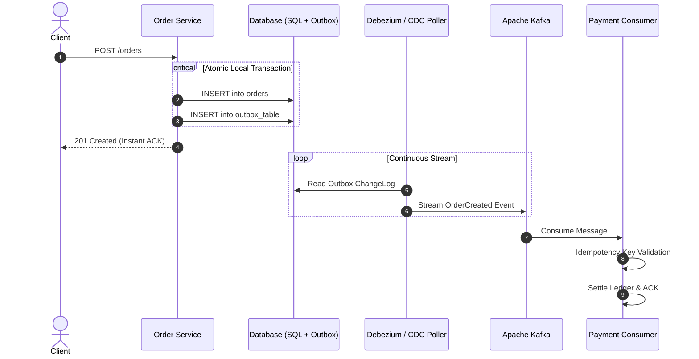

In distributed architectures, asynchronous communication through event streaming platforms like Apache Kafka offers decoupling and high throughput. However, naive implementations often break under high load or temporary network partitions.

## The Dual-Write Problem

A common architectural trap occurs when a service must simultaneously update its local SQL database and emit an event to Kafka. If the database commit succeeds but the message broker publish fails, the system enters an inconsistent state.

<figure class="my-8 overflow-hidden rounded-xl border border-slate-200 dark:border-slate-800 bg-white dark:bg-slate-900/60 shadow-sm excalidraw-container">
  

    

      
      Excalidraw Diagram • The Dual-Write Failure Mode
    

  

  

    
  

  <figcaption class="px-4 pb-4 text-xs text-center text-slate-500 dark:text-slate-400 font-mono">
    Figure 1: The Dual-Write Problem • Why direct broker publishing leads to silent data divergence
  </figcaption>
</figure>

### Architecture Sequence Flow

<figure class="my-8 overflow-x-auto rounded-xl border border-slate-200 dark:border-slate-800 bg-white dark:bg-slate-900/60 p-4 sm:p-6 shadow-sm">
  
  <figcaption class="text-xs text-center text-slate-500 dark:text-slate-400 mt-4 font-mono">
    Figure 2: Transactional Outbox Component Blueprint • Hand-drawn draw.io diagram (editable with embedded XML)
  </figcaption>
</figure>

### The Transactional Outbox Pattern
To guarantee consistency without heavy two-phase commit (2PC) protocols, record state changes and outbound messages within the same local database transaction using an Outbox table. A separate publisher thread or Change Data Capture (CDC) mechanism then streams events reliably to Kafka.

### Implementation: Transactional Outbox in Spring Boot 3

Here is the production implementation of the transactional outbox pattern ensuring atomic persistence of the business entity alongside the outbox event payload:

## Idempotent Consumers
Network re-deliveries are guaranteed in distributed networks. Every consumer must implement deterministic deduplication using idempotent keys stored with short-lived distributed caches or database unique constraints.

### Implementation: Idempotent Kafka Consumer with Redis

